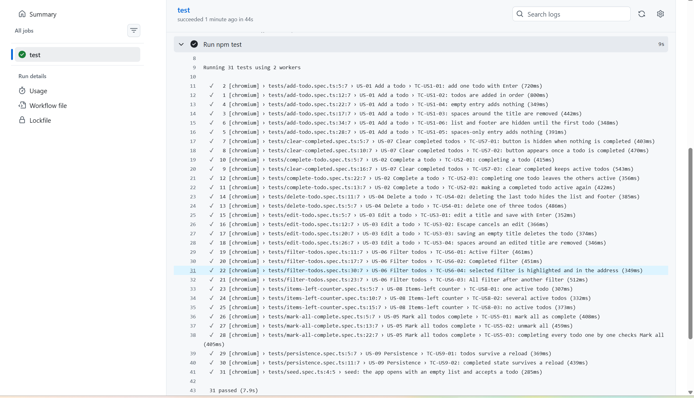

# AI-assisted test generation with Claude Code

A reviewed workflow that turns user stories into test cases and then into automated Playwright tests, using Claude Code skills. A person checks every step, and every mistake the AI made is recorded in [REVIEW_LOG.md](REVIEW_LOG.md).

The app under test is the public TodoMVC demo: https://demo.playwright.dev/todomvc

## Results



## The workflow

1. **Write the stories.** [docs/user-stories.md](docs/user-stories.md) has 9 user stories with numbered acceptance criteria (AC-1.1 and so on).
2. **Generate test cases.** The `/generate-test-cases` skill writes one Markdown file per story in [test-cases/](test-cases/). Every case has a type, priority, the criteria it covers, steps and an expected result. Unclear requirements go under "Open questions" and are not automated.
3. **Review the cases.** The `/review-test-cases` skill checks coverage, wording and duplicates. A person reads the result and decides.
4. **Generate the automation.** The `/generate-automation` skill turns each case into a Playwright test whose title starts with the case ID.
5. **Run, fix, log.** Failures are traced to the test or the app. Fixes are logged in [REVIEW_LOG.md](REVIEW_LOG.md).

## Skills

| Skill | What it does |
|---|---|
| `/generate-test-cases <story>` | Writes test cases and a coverage table for a story |
| `/review-test-cases <file>` | Reviews cases against the acceptance criteria |
| `/generate-automation <file>` | Writes Playwright tests for the cases in a file |

The skills are in [.claude/skills/](.claude/skills/). Project rules for Claude Code are in [CLAUDE.md](CLAUDE.md).

## Use it in VS Code

1. Open this folder in VS Code with the Claude Code extension.
2. In the Claude Code panel, type `/generate-test-cases` and the story, for example `US-03`.
3. Read the file it writes in `test-cases/`. Fix or reject anything wrong.
4. Run `/review-test-cases test-cases/US-03-edit-todo.md`.
5. Run `/generate-automation test-cases/US-03-edit-todo.md`.
6. Run `npx playwright test` and check the results.

## Project layout

```
docs/user-stories.md        input: stories and acceptance criteria
test-cases/                 generated, reviewed test cases (31 cases)
tests/pages/todo-page.ts    page object
tests/fixtures.ts           opens the app for every test
tests/*.spec.ts             Playwright tests, one per case
REVIEW_LOG.md               mistakes found and fixed
.claude/skills/             the three skills
```

## Run it

```
npm ci
npx playwright install chromium
npm test
npm run report
```

`npm run typecheck` checks the TypeScript.

## CI

[.github/workflows/ci.yml](.github/workflows/ci.yml) runs the type check and all tests on every push and uploads the HTML report as an artifact.

## How the first set was drafted

The first set of stories, cases and tests was drafted with Claude Code and then reviewed by a person. Selectors were written before they were run against the live app, so the first CI run was the real check. What that run found is in [REVIEW_LOG.md](REVIEW_LOG.md).
